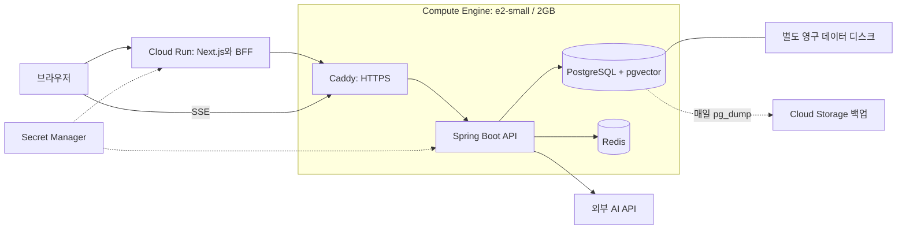

# GCP 최소 비용 배포 설계

요청: Terraform과 gcloud로 오구오구를 배포하고 실제 배포 전에 구조를 보여 준다.
기본 구성은 미국 us-central1의 e2-small 한 대와 요청 기반 Cloud Run 웹이다.
실제 project_id와 리전은 사용자 응답으로 확정한다. 현재 기본 프로젝트 hanjeok-prod를 자동 사용하지 않는다.

## 리소스와 데이터

- Terraform은 기존 GCP 프로젝트에 전용 VPC, 서브넷, 방화벽, 고정 IPv4,
  VM, 데이터 디스크, Artifact Registry, 백업 버킷, 서비스 계정, Secret Manager와 Cloud Run을 만든다.
- 부팅 디스크 20GB와 데이터 디스크 20GB는 pd-standard. 데이터 디스크는 자동 삭제하지 않고 prevent_destroy로 보호한다.
  Docker와 백업은 데이터 디스크 마운트와 UUID를 확인한 뒤 실행한다.
- VM 부팅 이미지는 Ubuntu 24.04의 정확한 이미지 이름으로 고정한다. startup-script는 metadata에 두어 수정만으로 VM을 재생성하지 않는다.
- VM은 80/443만 공개한다. SSH는 IAP 대역만 허용한다. PostgreSQL과 Redis는 Compose 내부에 있다.
- API 컨테이너 1GB, JVM heap 512MB, DB 384MB, Redis 128MB, Caddy 96MB로 시작한다.
  2GB swap은 순간 피크를 보완한다. 이 한도에서 실제 핵심 흐름 검증이 필요하며 결과에 따라 e2-medium으로 올린다.
- VM은 항상 실행되어 1초 레이드 flush와 AI 재시도, 주간 리포트가 계속 돈다.
- 웹은 최소 0, 최대 1인 Cloud Run이다. SSE는 브라우저에서 VM으로 직접 연결된다.
- 웹은 Cloud Run의 결정적 URL(service-projectnumber.region.run.app), API는 고정 IP 기반 sslip.io를 기본 사용한다.

## 시크릿과 배포

- Secret Manager의 api-env(JSON), bff-key, oauth-state-secret을 사용한다.
  Terraform은 시크릿 컨테이너만 생성하고 값과 버전을 관리하지 않는다. 비밀 값은 state와 VM metadata에 넣지 않는다.
- 내부 키는 로컬에서 난수로 생성할 수 있다. 실제 AI 키와 카카오/구글 클라이언트 값은 운영자가 준비해야 한다.
- 컨테이너는 Cloud Build에서 빌드하고 Artifact Registry에 올린다. 빌드 단계에 운영 비밀 값은 전달하지 않는다.
- Terraform은 이미지 URI를 변수로 받는다. 초기 apply는 이미지 없이 기반 리소스만 만든다.
  시크릿 업로드와 이미지 빌드 뒤 saved plan을 적용하고 IAP로 API 배포를 실행한다.
- API 배포 실패 시 직전 이미지로 복구한다. 스키마 변경을 되돌리는 것은 별도 판단이며 자동 DB 롤백은 하지 않는다.
- 매일 DB 덤프를 Cloud Storage에 보관한다(14일). 분리된 디스크는 백업을 대신하지 않는다.

## 비용과 완료 조건

us-central1, 월 730시간 기준 VM 약 $12.23와 IPv4 약 $3.65에 디스크를 더한다.
기본 합계는 월 약 $16~18. 웹 사용량, AI, 백업, 트래픽, 이미지 저장, 세금은 별도다.
무료 할당은 결제 계정의 다른 프로젝트와 공유하며 무료 체험 크레딧은 견적에서 제외한다.

완료 조건은 terraform validate/test, shellcheck, 배포 롤백 테스트, 웹 타입 검사와 빌드,
실제 saved plan의 생성/삭제 목록 확인, 운영 API와 웹 헬스, 가입부터 알림까지의 검증이다.
프로젝트 ID, 리전, 결제와 실제 운영 키가 없으면 실제 apply는 보류하고 검증된 구성을 전달한다.
