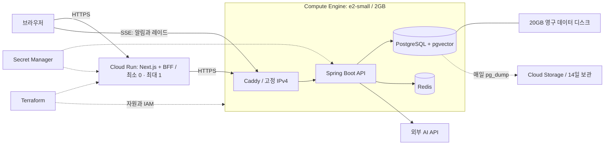

# GCP 배포

Terraform으로 기반 자원을 관리하고 gcloud/Cloud Build로 이미지를 빌드한다.
기본 구성은 us-central1, e2-small 한 대, Cloud Run 웹이다.



## 비용과 운영 범위

us-central1, 월 730시간 기준 e2-small 약 $12.23, 외부 IPv4 약 $3.65이다.
20GB 부팅 디스크와 20GB 데이터 디스크를 합쳐 기본 비용은 월 약 $16~18이다.
디스크 무료 할당이 남아 있는지에 따라 달라진다. 무료 할당은 결제 계정 전체에서 공유한다.
웹 요청, AI, 트래픽, 백업과 이미지 저장, Cloud Build, 세금은 별도다.

- [VM 요금](https://cloud.google.com/products/compute/pricing/general-purpose)
- [IPv4 요금](https://cloud.google.com/vpc/network-pricing)
- [무료 할당](https://docs.cloud.google.com/free/docs/free-cloud-features)
- [Cloud Run 요금](https://cloud.google.com/run/pricing)

이 구성은 소규모 포트폴리오용이다. 단일 VM이므로 VM 장애 동안 API와 DB는 함께 중단된다.
API 1GB(heap 512MB), DB 384MB, Redis 128MB, Caddy 96MB와 swap 2GB로 시작한다.
실제 핵심 흐름과 배치에서 OOM/지연을 확인하고 부족하면 machine_type을 e2-medium으로 바꾼다.
사양 변경 시 Terraform이 VM을 정지 후 재시작하므로 잠시 서비스가 중단된다.
VM에는 빌드 도구나 Gradle/Node 빌드를 올리지 않는다.

## 1. 대상 프로젝트와 인증

사용자가 승인한 기존 프로젝트를 사용한다. gcloud의 현재 기본 프로젝트는 참조하지 않는다.
프로젝트 생성과 결제 연결은 별도 작업이다. 다른 서비스 프로젝트를 기본값이라는 이유로 사용하지 않는다.

```bash
gcloud auth application-default login
cp infra/gcp/terraform/terraform.tfvars.example infra/gcp/terraform/terraform.tfvars
```

terraform.tfvars의 project_id를 실제 ID로 바꾼다. 서울이면 region=asia-northeast3,
zone=asia-northeast3-a로 함께 바꾸고 서울 기준 견적을 확인한다.
배포자는 API 활성화, IAM, Compute/Cloud Run, Storage, Secret Manager, Artifact Registry,
Cloud Build 자원 생성 권한과 서비스 계정 사용 권한이 필요하다. SSH는 OS Login과 IAP를 사용한다.

Terraform state는 우선 로컬에 저장하며 .gitignore로 제외한다. 이 디렉터리의 state와 백업을
안전하게 보관한다. 시크릿 값은 state에 들어가지 않는다. 여러 사람이 운영하게 되면 별도
비공개 GCS state 버킷과 backend로 이전해 잠금을 공유한다.

## 2. 검증 후 기반 자원 생성

```bash
terraform -chdir=infra/gcp/terraform init
terraform -chdir=infra/gcp/terraform fmt -check -recursive
terraform -chdir=infra/gcp/terraform validate
terraform -chdir=infra/gcp/terraform test
terraform -chdir=infra/gcp/terraform plan -out=foundation.tfplan
terraform -chdir=infra/gcp/terraform show foundation.tfplan
terraform -chdir=infra/gcp/terraform apply foundation.tfplan
```

plan에서 기존 자원 삭제/교체가 없는지, target project와 리전, e2-small, 디스크 20+20GB,
고정 IPv4를 확인한다. 첫 apply는 api_image/web_image가 비어 있어 앱을 배포하지 않는다.
VM은 Docker, 데이터 디스크와 swap, systemd, 백업 실행 환경만 준비한다.
첫 apply부터 VM/IP 비용이 발생한다.

## 3. 실제 운영 자격 증명

JSON 파일을 `infra/gcp/secrets/credentials.json`에 준비한다(이 디렉터리는 업로드/커밋에서 제외).
필드는 AI_API_KEY, KAKAO_CLIENT_ID, KAKAO_CLIENT_SECRET, GOOGLE_CLIENT_ID, GOOGLE_CLIENT_SECRET이다.
필수 운영 값이 비면 API가 기동하지 않는다. 비밀 값을 채팅이나 PR에 붙이지 않는다.
구글만 사용할 때는 `terraform.tfvars`에 `kakao_login_enabled = false`를 지정하고
아래 prepare-secrets 명령에 `--without-kakao`를 붙인다. 이때 카카오 ID와 시크릿은 없어도 된다.
웹의 카카오 버튼과 웹/API의 카카오 인증 요청이 함께 비활성화된다.

AI 친구(009)는 꺼진 채로 배포된다. `specs/009-ai-companions/quickstart.md`의 운영 준비를 마친 뒤
`terraform.tfvars`에 `ai_companion_enabled = true`를 지정하고 apply한다. 하루에 AI에 댓글을 청하는 횟수
(`ai_companion_daily_limit`, 기본 30)와 기다리는 시간(`ai_companion_wait`, 기본 `10m`)도 같은 곳에서 바꾼다.
끄려면 `false`로 되돌리고 다시 apply한다. 이미 남긴 댓글은 그대로 남는다.

```bash
python3 infra/gcp/scripts/prepare-secrets.py infra/gcp/secrets/credentials.json
bash infra/gcp/scripts/upload-secrets.sh
terraform -chdir=infra/gcp/terraform output web_origin
```

prepare-secrets는 JWT, DB/Redis 비밀번호, BFF 키, OAuth 상태 서명 키를 생성하고 파일 권한을 600으로 둔다.
기존 파일이 있으면 덮어쓰지 않는다. upload-secrets는 이미 enabled 버전이 있으면 그대로 둔다.
시크릿을 교체할 때는 DB 암호 변경과 기존 로그인 만료 영향을 별도로 판단한다.

web_origin 출력으로 카카오/구글 개발자 콘솔의 redirect URI를 등록한다.
`<web_origin>/api/auth/oauth/kakao/callback`, `<web_origin>/api/auth/oauth/google/callback`이다.
terraform.tfvars의 kakao_client_id/google_client_id에도 실제 client ID를 넣는다(비밀 키가 아닌 공개 ID).

### 웹에 도메인 붙이기

`terraform.tfvars`의 `web_domain`에 호스트 이름(예: `new.5959.site`)을 넣으면 Cloud Run 도메인 매핑이 생기고
web_origin이 그 주소로 바뀐다. 웹의 APP_ORIGIN, API의 SSE 허용 출처와 OAuth redirect URI가 함께 따라간다.
run.app 주소는 계속 응답하지만 로그인과 실시간 알림은 web_origin에서만 된다.

1. apply하는 구글 계정이 도메인의 확인된 소유자여야 한다. `gcloud domains list-user-verified`에 나오지 않으면
   Search Console에서 그 계정으로 확인하거나 소유자로 추가한다.
2. DNS에 `CNAME <호스트> ghs.googlehosted.com.`을 넣고, 개발자 콘솔에 새 redirect URI를 추가한다.
3. 매핑만 먼저 만든다. 인증서가 나올 때까지(보통 15분에서 몇 시간) 출처는 바꾸지 않는다.
   `-target`은 웹 서비스까지 함께 바꾸므로 쓰지 않는다.
   `gcloud beta run domain-mappings create --service=ogu-web --domain=<호스트> --region=<리전> --project=<프로젝트>`
4. `https://<호스트>/api/health`가 열리면 `web_domain`을 tfvars에 적고 매핑을 state로 가져온 뒤 전체를 apply하고
   `deploy-api.sh`를 실행한다. tfvars에 적기 전에 가져오면 다음 apply가 매핑을 지운다.
   `terraform import 'google_cloud_run_domain_mapping.web[0]' locations/<리전>/namespaces/<프로젝트>/domainmappings/<호스트>`
5. 웹 트래픽은 릴리스가 이름으로 고정한 revision에 묶여 있다. apply가 만든 새 revision은 트래픽을 받지 않으므로
   `gcloud run services update-traffic ogu-web --to-revisions=<새 revision>=100`으로 옮기거나 다음 main 릴리스를 기다린다.

## 4. 이미지 빌드와 앱 배포

```bash
bash infra/gcp/scripts/build-images.sh
terraform -chdir=infra/gcp/terraform plan -out=release.tfplan
terraform -chdir=infra/gcp/terraform show release.tfplan
terraform -chdir=infra/gcp/terraform apply release.tfplan
bash infra/gcp/scripts/deploy-api.sh
```

build-images는 현재 작업 폴더를 Cloud Build로 보내 두 이미지를 만들고, digest를
release.auto.tfvars에 기록한다. `.gcloudignore`와 `.dockerignore`는 시크릿/state/원본 subtree를 제외한다.
다음 apply는 VM metadata의 이미지 URI를 갱신하고 실제 웹을 만든다. VM을 재생성하지 않는다.
API는 IAP SSH로 bootstrap을 재실행해서 배포한다. 실행 환경은 root만 읽는 `.env.json`에 보관하고
Compose에는 프로세스 환경변수로 전달해 비밀 값의 따옴표와 역슬래시를 그대로 유지한다.
다운받기와 헬스 체크에 실패하면 직전 env와
API 이미지로 복구한다. 첫 배포에는 이전 이미지가 없어 API/Caddy만 멈추며 DB는 남긴다.

배포 도중 앱의 스키마가 바뀌었다면 이미지 롤백만으로 호환성이 회복되는지 확인해야 한다.
이 스크립트는 DB 스키마를 자동 되돌리지 않는다. 기존 Oracle용 Release 워크플로는 그대로이며,
이 GCP 경로는 수동으로 실행한다. `main` 생성이나 기존 CI/CD 활성화는 필요하지 않다.

## 5. 운영 확인

terraform output의 api_origin/web_origin에서 다음을 확인한다.

1. API `/actuator/health`의 status가 UP이고 웹 `/api/health`가 정상이다.
2. 이메일 가입과 로그인, 온보딩, 글 작성, 몬스터 생성, 댓글/공감, 실시간 알림과 레이드.
3. 카카오/구글 로그인은 등록한 redirect URI와 일치한다.
4. IAP에서 `sudo journalctl -u ogu.service`와 `sudo docker stats --no-stream`으로 OOM과 메모리를 확인한다.
5. `sudo python3 /opt/ogu/backup.py`를 실행하고 백업 버킷에 덤프가 올라오는지 확인한다.
6. 분리된 테스트 DB에 pg_restore로 복구하고 Flyway 버전과 주요 테이블 행 수를 대조한다.

VM 재부팅 때 기존 ext4 데이터 디스크는 포맷하지 않는다. unknown signature는 자동 덮어쓰지 않는다.
Docker와 배포/백업은 `/var/lib/ogu`의 UUID가 연결한 데이터 디스크와 일치해야 실행된다.
데이터 마운트가 실패하면 Docker도 시작하지 않으므로 부팅 디스크에 새 DB가 만들어지지 않는다.
Caddy 인증서도 데이터 디스크에 저장한다. Redis는 영속화하지 않으므로 재시작 때 직전 1초
레이드 공격을 잃을 수 있으며 이는 기존 설계의 한계다.

## 검증 명령

```bash
python3 -m unittest discover -s infra/gcp/tests -v
shellcheck infra/gcp/vm/*.sh infra/gcp/scripts/*.sh
bash infra/tests/deploy_test.sh
pnpm --filter web exec vitest run src/shared/config/env.test.ts
pnpm --filter web typecheck
pnpm --filter web build
```

Terraform mock tests는 실제 클라우드 자원을 만들지 않는다. 실제 apply와 운영 검증은 별도다.
VM/데이터 디스크/백업/시크릿은 삭제를 보호한다. 회수할 때 먼저 백업을 검증하고 해당 보호를
명시적으로 해제한 후 destroy plan을 검토한다. VM을 정지해도 디스크와 고정 IP 비용은 남는다.
